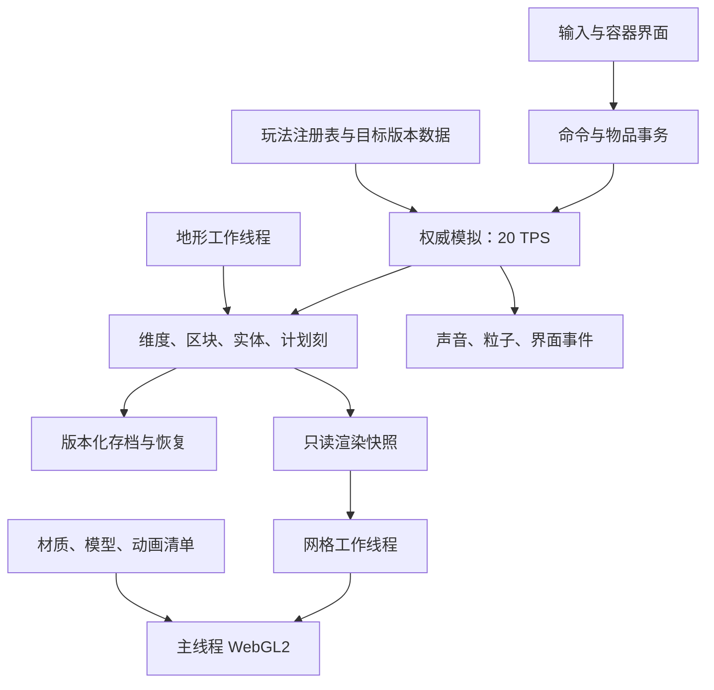

# htgame：面向 Minecraft Java 1.20+ 的项目设计

日期：2026-10-22。本文为实施方案，尚未执行重构或新增玩法。当前进度与证据见 [现状审计](01-current-state-audit.md)，多人开发规则见 [agent 协作方案](03-agent-work-plan.md)。

## 1. 目标与版本边界

把现有项目演进成能够长期游玩的浏览器单人 Minecraft 复刻：建设、探索、生存、自动化和通关形成闭环，尽量使用原版规则，视觉统一使用给定 Pixel Perfection 材质包。

建议将“1.20+”拆成明确的交付版本：

| 层级 | 目标 | 范围 |
|---|---|---|
| V1 | Java 1.20.1 核心体验 | 现代世界高度、三维度、完整生存通关、现代战斗、关键自动化与村民系统、1.20 主题玩法 |
| V2 | Java 1.20.6 内容与规则补齐 | 补齐 1.20.x 差异，包括犰狳、狼变种、狼铠及相关行为；逐项扩大覆盖矩阵 |
| V3 | 1.21+ 按版本扩展 | 独立内容包加入合成器、试炼密室、旋风人、重锤等；每批写明目标版本，不随“最新版”浮动 |

版本选择是设计建议，避免同时模仿 Java 与基岩版的不同规则。1.20 核心特性、1.20.5 的内容及物品组件变化、1.21 的新机制分别以官方发行说明为基准：[1.20](https://feedback.minecraft.net/hc/en-us/articles/16499677456781-Minecraft-Java-Edition-1-20-Trails-Tales)、[1.20.5](https://www.minecraft.net/en-us/article/minecraft-java-edition-1-20-5)、[1.20.6](https://www.minecraft.net/en-us/article/minecraft-java-edition-1-20-6)、[1.21](https://www.minecraft.net/en-us/article/minecraft-java-edition-1-21)。

“尽可能原版”需要拆成三个独立指标：

1. **内容覆盖**：有多少目标方块、物品、生物、群系、结构与维度。
2. **行为一致性**：获取、合成、掉落、碰撞、更新顺序、战斗和存档是否符合目标规则。
3. **体验完整性**：能否不靠命令走完生存链、搭建农场并长期保存，操作与表现是否稳定。

资源注册数量不能代替行为验收。首期不承诺与 Java 原版同种子地形逐格一致、直接读取原版世界或加入原版服务器；这些属于独立兼容工程，需要单独的算法、格式或协议实现。联机纳入远期设计，但不阻塞单机核心完成。

## 2. 总体策略：保留可用部分，逐步替换基础

保留现有 WebGL2、AO/光照、实体模型、交互逻辑中可复用的实现。采用 ES Modules 拆分，全新公共接口优先使用 TypeScript；旧代码通过适配器逐步迁移。无需为了新增玩法整体换引擎，也无需先重写全部渲染系统。

先恢复正确性，再扩展容量，最后批量扩内容。避免在 256 项方块 ID、全局变量、单个 Game 大类上继续堆积系统。



第一阶段模拟可仍在主线程，但必须与 DOM/WebGL 解耦；优先移走重地形与网格计算。只有性能数据证明有必要时，才把整个权威模拟迁入独立 Worker。不能让多个 Worker 同时随意写世界。

推荐目标目录，目录中的名称是规划，不表示已存在：

```text
src/
  app/                  启动、场景生命周期、输入装配
  contracts/            版本化公共类型、命令、事件、Worker协议
  registry/             方块状态、物品、实体、群系注册与校验
  world/                维度、区块、照明、加载票据、世界生成
  simulation/           时钟、调度、事务、系统执行顺序
  gameplay/
    inventory/ crafting/ combat/ effects/ fluids/ redstone/
    entities/ villagers/ portals/ progression/
  persistence/          区块仓库、快照、迁移、导入导出
  render/               网格、材质、模型、天气、手持物品
  assets/               资源解析器与运行时管理
  audio/                声音事件与空间音频
  ui/                   HUD、容器、菜单、无障碍与输入
  workers/              生成和网格任务入口
content/java-1.20.1/     方块、物品、配方、掉落、结构与规则数据
content/java-1.20.6/     后续版本差异与扩展
tools/assets/           统一资源构建入口
tests/                  规则、存档、契约与跨系统场景
fixtures/               固定世界、旧存档和验收场景
```

## 3. 关键数据与系统设计

### 3.1 注册表与方块状态

- 持久身份使用 `minecraft:oak_stairs` 这类命名空间字符串；运行时用紧凑整数 StateId，提高热路径访问效率。
- 方块定义与状态分离：楼梯状态包括 facing/half/shape/waterlogged；红石包括 power、延迟或开关状态，不再将含义散落在裸数字和不透明 meta 位运算里。
- StateId 与 GPU 纹理层号完全分离。纹理包变化不改变玩法 ID，注册顺序变化不改变存档含义。
- 首期运行时可用 Uint32Array；存档每 section 保存名称/状态 palette 与压缩索引。随后按实际数据优化位宽，避免提前实现复杂压缩。
- 定义明确的碰撞、选取、遮挡、支撑、可替换、流体占位规则。视觉模型不能自动决定这些规则。
- tags 描述 logs/planks/mineable 等集合；配方、战利品和工具规则引用 tags，避免每加一种木头都改核心函数。
- 数据装载时检查重复 ID、未知引用、不可达配方和缺失资源；未知存档内容使用可恢复占位并保留原始数据，不能静默变空气。

### 3.2 世界高度、区块与生成

主世界采用 `minY=-64, height=384`，可放置坐标为 -64..319，上边界为 320。现代世界扩高及洞穴/矿脉基础来自 [Java 1.18 官方说明](https://www.minecraft.net/en-us/article/caves---cliffs--part-ii-out-today-java)。下界和末地使用各自 DimensionSpec，不复用主世界高度与天空参数。

- 采用稀疏 16³ sections；统一世界 Y→sectionY→localY，负坐标使用数学 floor。
- key 为 `(dimensionId,cx,cz)`、`(dimensionId,cx,sy,cz)`；取消目前 ckey 范围假设及“区块 key×16”的隐式编码。
- 渲染距离、模拟距离、实体激活距离分开；以 chunk tickets 管理玩家、传送门和任务需要的加载区域。
- 生成过程分为基础密度、地表、洞穴/含水层、矿物、结构、植被、初始实体。随机流按 seed/维度/坐标/阶段独立派生，避免加载顺序改变结果。
- 结构跨区块放置由确定的结构起点和片段处理；不允许重复生成宝箱、村民或战利品。
- 保存 generatorVersion。旧世界默认继续用旧生成器；新高度世界走新版本。高度转换应输出新存档副本，保留玩家建筑，不原地重生成已探索区域。
- 真正追求同种子原版一致时，需要另立项目复制完整噪声路由、随机算法、结构布置与版本数据；本方案先达到地貌、资源分布与探索体验接近。

### 3.3 模拟、物品与事件

- 维持 20 TPS 固定步长，渲染插值。前台过载、暂停、切后台的时钟规则写入设计并可观察；不能无提示丢时间又声称精确模拟。
- 所有方块改变通过 WorldCommands 提交，统一触发邻居更新、光照、计划刻、存档 dirty 与表现事件。
- 明确内部阶段顺序：输入命令、计划更新、实体/容器、随机刻、整理事件。对需要 Java 精确时序的红石组件再用参考场景校准；自定一个顺序本身不等于原版一致。
- 玩家动作、AI、天气使用可保存的独立 RNG 流；视觉粒子的随机性可独立，不影响玩法结果。
- ItemStack 由 itemId、count、components 组成，components 包含耐久、附魔、名称、药水、容器、纹饰等。内部格式无需盲目复制原版序列化，但应能表达后续版本属性。
- 合成、熔炼、交易、铁砧、拖拽、拾取、漏斗转运使用统一事务：先验证输入、输出容量和版本，再一次性提交消耗与产出；失败不得留下部分修改。
- UI 发命令并显示结果；不能直接改玩家背包或实体数组。掉落实体也要有一致的物品身份与堆叠规则。
- 计划刻携带维度、位置、触发 tick、优先级、稳定序号和事件种类；区块未加载时保留事件，按该区块模拟策略恢复。

### 3.4 存档与迁移

采用 `WorldManifest + ChunkSnapshot + EntitySnapshot + ScheduledTicks`，主 manifest 包含 schemaVersion、rulesVersion、generatorVersion、registryHash、assetPackHash、维度配置和 checkpointId。

- IndexedDB 按需读取区域，内存使用有界 LRU；不再启动时载入所有改过的区块。
- 保存先取不可变快照，记录每块 revision；事务成功后仅清除对应 revision，期间发生的新修改继续保留。
- 同一 checkpoint 中的玩家、方块、容器、实体和计划刻保持原子一致。首期使用跨 stores 的单事务；规模扩大时采用“分批写快照→最后提交根指针”的可恢复方案。
- serialize 保存队列，避免自动保存、退出保存和后台保存相互覆盖。失败保留 dirty，错误可见且能重试。
- 保存全部持久实体，包括尚未加载的实体；区块卸载前落盘，不能只遍历当前活动 entities。
- 保存附魔 seed、运行中的炉子、红石计划事件、结构生成标记与战利品生成状态。光照和网格可重建，不作为权威存档。
- 旧格式 migration 必须版本化；先导出备份，转换到新世界记录，校验成功再切换。首次转换保留旧 ID→新名称映射。
- 提供世界导入/导出、配额错误提示和最近成功 checkpoint。内存回退应明确显示“本次进度不会持久保存”。

### 3.5 性能与表现

生成/网格任务输入为不可变快照，携带维度、section、revision、registryVersion 和邻域信息。输出包含相同标识；过期结果丢弃。Worker 不读 DOM、不操作 WebGL、不直接修改权威世界。

优先使用 transferable buffers 和显式所有权；传输快照不能误把活跃世界数组 detach。共享内存、OffscreenCanvas 和全 GPU 路线暂不作为前置条件。

网格按 section 建立队列和上传预算，邻居改变能正确使边界失效；保留现有 AO。仅在材质、光照、AO、UV 可兼容时做面合并，避免贪心合并破坏像素纹理和阴影。透明块独立通道，先修明显排序问题，再决定更复杂方案。

查询 GPU texture array 层数等限制，按材质组分页；支持上下文丢失后的资源恢复。UI 图标按需缓存，避免每次全量读回 GPU。对标题、按钮九宫格、背包布局、HUD 和中文字体分别建立参考图，避免纹理可加载但布局失真。

建议在选定参考机器后采用以下性能目标；这些是未来门槛，不是本次测得的数据：1080p、DPR≤2、渲染距离8/模拟距离4、100个活动实体场景，稳定时中位帧耗时≤16.7ms、P95≤33.3ms，模拟 tick P95≤25ms。持续探索时记录>100ms长帧数量、内存、网格/GPU buffer数量；往返相同路径后缓存规模应趋于稳定。先建立基线，再决定更高视距门槛。

## 4. Pixel Perfection 资源方案

无需手绘。指定 ZIP 是主要素材源，当前 assets.js 已使用它。优先完善导入器与资源索引，而不是另外生产纹理。

```text
ZIP扫描 → 路径/overlay规范化 → 引用检查 → 模型继承解析
       → blockstate烘焙 → 纹理/动画/声音分包 → manifest与覆盖报告
```

必须完成：

1. 合并 build_assets.py/build_from_pack.py 为一个入口。构建配置显式选择包、玩法版本和允许的 fallback。
2. 导入模型 parent、textures 引用、elements、UV、rotation、cullface/tintindex；支持 blockstates variants/multipart、旋转与 uvlock。资源包是覆盖包，缺少的父模型需要标准模板库或可选基础资源输入，不能假定 ZIP 自包含全部模型。
3. 完整保存动画 frametime、frames 顺序、单帧 time 和 interpolate；支持元数据定义的尺寸与帧布局。
4. 将透明、cutout、emissive 分开处理，不继续用统一 alpha 清洗代替材质语义。CTM、随机实体和自定义实体模型作为后续兼容层，明确支持清单。
5. 接入包内 OGG，以项目声音事件表映射路径、随机变体、音调、音量、空间衰减和字幕。现有 sounds.json 不覆盖全部声音，缺失事件可保留程序合成回退并在报告中标记。
6. 床、刷怪蛋等利用现有包内纹理裁切、组合与染色消除不必要 fallback；中文字体选择合法可用字体资源或系统回退，保持稳定布局。
7. 输出每项来源、hash、缺失项、fallback、未支持特性和覆盖率，避免“全部导入了”等含混结论。生成文件不手工合并。

输出建议：asset-manifest.json、baked-models、纹理分页、animation-definitions、sound-events.json、asset-report.json。仅打包已引用资源，按维度/内容组延迟加载；保留包作者信息、原始说明及资源来源记录。

## 5. 内容建设路线与交付条件

| 阶段 | 工作重点 | 可交付闭环 / 出口条件 |
|---|---|---|
| M0 可靠基线 | 修复物品事务、保存重试、pending实体、附魔seed；清理重复红石；建立Git/检查入口 | 满背包合成/拖拽不增殖不吞属性；故障保存能重试；远处农场与计划事件保留。先有迁移策略再改格式 |
| M1 接口和数据 | 模块化、registry/BlockState/ItemStack、命令事件、版本化存档、legacy adapter | 当前玩法通过新接口运行；旧存档能转换到副本；新方块无需修改Game大类 |
| M2 世界与资源 | 负高度/稀疏section、多维度容器、按需存档、Worker、现代生成骨架、统一材质管线 | 在负高度和跨区块建造/照明/保存恢复正确；高ID方块不截断；资源构建可重复 |
| M3 生存规则 | 正确配方与掉落来源、现代战斗/副手/盾、伤害/状态效果、装备、附魔完善、酿造基础 | 从空背包走到钻石装备与附魔，不靠假配方；死亡恢复、装备与效果存档正确 |
| M4 三维度通关 | 下界与传送门、堡垒/烈焰人、末影人/珍珠、要塞/末地、龙与出口 | 不开创造、不用give完成主世界→下界→末地→击龙→返回；传送往返和跨维度保存正确 |
| M5 自动化与社会 | 红石更新、活塞/比较器/侦测器、容器运输、轨道车辆、村民职业/交易/补货 | 可运行自动熔炉、物品分类、活塞农场、交易所；卸载重载后行为连续、物品守恒 |
| M6 1.20与广度 | 樱花/竹木、考古/古迹、纹饰/锻造、骆驼/嗅探兽、告示牌/书架/传感器；扩充旧版基础内容 | 完成探索→考古→获取模板/陶片→装饰或装备的闭环；每种新内容有来源、行为、保存与资源映射 |
| M7 终局与1.20.6 | 末地城/潜影贝/鞘翅、凋灵/信标等终局完善；狼/犰狳等版本差异；全矩阵补齐 | 正常生存获得终局资源，跨区块/维度状态可靠；明确声明仍近似的机制 |
| M8 可选扩展 | 1.21+内容、多人、原版格式/协议、精确生成兼容 | 各自独立版本与验收，不混入前期基本功能承诺 |

M2 不必等待所有群系/结构做完才开始 M3；M3 的酿造等内容可先做好机制，到 M4 通过真实下界材料验收。替代配方在真实来源补齐时移除，过渡版明确标记未接通内容，不能为了临时可获得而引入新假配方。

M4 的“能通关”不是原版完成：M5–M7 仍须补足沙盒深度。完整内容清单至少包含以下工作包：

| 工作包 | 必须考虑的范围 |
|---|---|
| 方块族 | 全木种、石材/深板岩/铜/紫水晶、楼梯内外角、墙/栅栏/门连接、含水、支撑和多格方块；染色族用数据生成 |
| 生态与探索 | 主世界地表/地下/海洋群系，沼泽/红树林、繁茂/溶洞/深暗之域，结构与战利品；下界各群系、末地外岛 |
| 生物行为 | 水生、驯服/繁殖、坐骑、飞行、敌对、Boss；先共用感知/导航/目标系统，再加入个体能力；不能只有皮肤与hp |
| 生存系统 | 食物与饱和、完整伤害类型、药水/酿造、装备/附魔/修复、钓鱼、睡眠、难度、游戏规则、进度 |
| 村民与袭击 | 职业/工作站/床/作息、交易等级/价格/补货、声望与治愈、繁殖、傀儡、灾厄村民和袭击 |
| 自动化 | 活塞移动事务、强弱充能、比较器容器读数、观察者脉冲、漏斗冷却、发射器行为、矿车；Java特有边界需专门场景验证 |
| 交通与终局 | 船/筏、矿车/轨道、坐骑、鞘翅/烟花、潜影盒、地图/定位工具、末地城、凋灵/信标 |
| 1.20特色 | 樱花树林/木族、竹木/筏、考古/可疑方块/陶罐/古迹、纹饰与升级模板、骆驼、嗅探兽/古代植物、悬挂告示牌、雕纹书架、校频幽匿感测体 |
| 界面与命令 | 各种容器、配方书、设置、键位、可读提示与字幕、创造搜索；命令逐条记录兼容级别，后续再扩数据包支持 |

项目应建立 `feature-matrix.csv`：featureId、目标版本、当前状态、依赖、获取路径、资源覆盖、行为场景、持久化场景、负责人、证据。状态使用“缺失/数据已注册/可交互/规则对齐/已验收”，不能以“有一个类”标为完成。

## 6. 验收设计与执行节奏

用户已确认现有基础体验，因此后续检查集中在改动范围和跨系统边界，不重复证明游戏能打开。每个新增机制的完成条件都包含：能取得、能使用、产生正确结果、能保存恢复、能与相关机制组合。

优先固定下列回归场景：满背包批量合成；带名称/附魔的拖拽物品；保存失败重试；未访问远处农场即保存；跨边界灯光和流体；红石延迟后卸载/重载；负Y边界；传送门往返；漏斗与玩家同时取物；村民补货/职业保持；龙死亡与出口状态。

规则测试运行纯模拟，无需 GPU；表现验收才使用浏览器参考图。存档做旧版本 fixtures 与故障注入；生成验证相同 seed 的加载顺序独立性；资源构建验证引用完整和可重复输出。红石使用一组参考电路，而不是仅测试单个按钮点灯。

排期以里程碑出口为准。先完成 M0/M1 的一个小交付周期，测量实际吞吐量与返工量，再估算后续日历时间；不把“3个 agent”简单当作3倍速度。M2 的结构迁移和 M4 的完整通关通常是关键路径，接口和集成时间必须独立留出。
